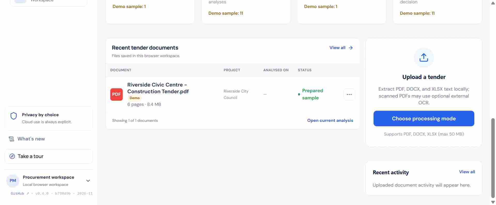
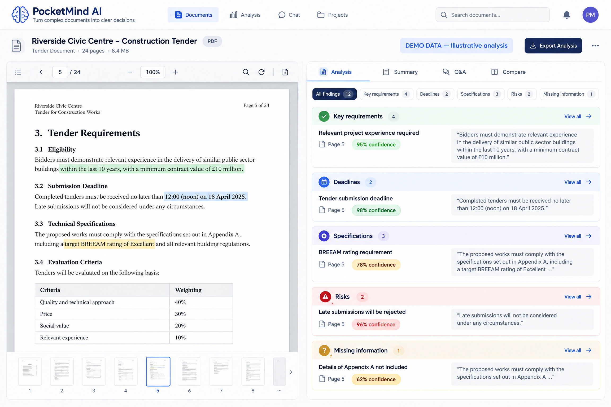
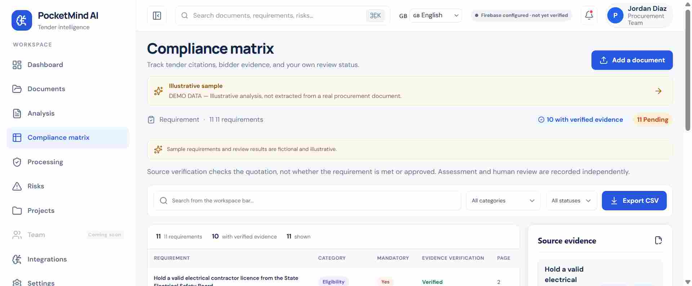

# PocketMind AI

> **#BuildHybridAI 2026 submission — Web (Chrome) · Firebase AI Logic hybrid inference**

**Live demo:** [ai-mind-law.vercel.app](https://ai-mind-law.vercel.app/) · **Source:** [maurolima-sys/ai-mind-law](https://github.com/maurolima-sys/ai-mind-law)

## What we built

PocketMind AI turns procurement documents into a structured, human-reviewable workspace. Reviewers can add PDF, DOCX, and XLSX files up to 50 MB; text is extracted in the browser with PDF.js, Mammoth, or ExcelJS. Under explicit consent, extracted text can be analyzed through Firebase AI Logic in cloud-only, on-device-only, or on-device-first hybrid mode. Findings link to a verified PDF page or a labelled DOCX/XLSX source section, so a person can check each excerpt before acting on it.

The core problem: tender documents run to dozens of pages of dense prose. The obligations that decide whether a bid is eligible, technically compliant, and commercially sound are buried in that text. Reviewers re-read, cross-reference, and still miss things. PocketMind AI organizes extracted text, verifies excerpts against their cited source, and surfaces a compliance matrix for review, notes, and export. Uploaded tenders, extracted text, analyses, bidder evidence, comparisons, and review state persist in IndexedDB in the current browser; they are not encrypted or synced.

## Firebase AI Logic — how it's used at runtime

- **Hybrid inference (on-device-first):** Firebase AI Logic's web hybrid API (`getGenerativeModel` with `InferenceMode.PREFER_ON_DEVICE`) is called in `src/lib/services/firebaseAi.ts`. The app requests on-device inference via Chrome's Prompt API first; if the model is unavailable, the SDK falls back to Gemini in Google's cloud. The actual inference source reported by the SDK (`on-device`, `cloud`, `cloud-fallback`) is surfaced to the user after every analysis.
- **Cloud-only and on-device-only modes:** selectable from the Processing & privacy screen, both implemented through the same Firebase AI Logic SDK with different `InferenceMode` values.
- **App Check:** enforced for all Firebase AI Logic calls. Development uses the App Check debug provider, which may print a debug token to the browser console; never share or commit that token. Production uses reCAPTCHA Enterprise and requires its site key for the deployed domain.
- **Document Q&A:** follow-up questions about extracted PDF, DOCX, or XLSX text use the same inference path, separating stated facts, working hypotheses, and unresolved questions, with citations to pages or source sections.

## What makes this a non-obvious use of hybrid inference

Most hybrid AI demos run a single prompt against a fixed input. PocketMind AI applies hybrid inference to a *document review workflow* where the inference source matters to the user: sensitive procurement documents may not leave the device; the app surfaces which model actually ran and requires explicit consent before any cloud path is used. The on-device preference is a product feature, not an implementation detail.

## Who it's for

Procurement and tendering teams, consultants, and anyone who reviews public or private tenders. The workflow is: upload → choose processing mode → analyze → verify findings against their source → attach bidder evidence to requirements and compare it → track review status → export CSV or JSON.

## Built during the submission period

The repository began as a standard TanStack/Lovable starter during the submission period and was substantially rebuilt into PocketMind AI. Work completed during the submission period includes: Firebase AI Logic hybrid inference integration, App Check setup, local PDF/DOCX/XLSX extraction and storage, source verification, the compliance matrix with persistent per-requirement review tracking, bidder evidence linking and comparison, document Q&A with structured fact/hypothesis/unresolved separation, optional LlamaParse OCR for scanned PDFs (via the Lovable connector), optional Firecrawl external research (server-side only), and the Dashboard, Library, Document analysis, Compliance matrix, and Processing & privacy screens.

## Product screens








## What works

- Upload PDF, DOCX, and XLSX files up to 50 MB and extract text locally in the browser. PDF text retains page numbers; Office documents use paragraph, sheet, and row-range source labels.
- Keep tender files, extracted text, analyses, review notes, evidence files, comparison results, and activity in a persistent local browser library. This IndexedDB data is not encrypted or synced and can be deleted from the library.
- Offer optional LlamaParse OCR for scanned or very sparse PDFs, only after separate per-document consent and when the Lovable connector is enabled.
- Run Firebase AI Logic analysis in cloud-only, on-device-only, or on-device-first hybrid mode. Cloud processing and fallback require explicit consent.
- Show the actual inference source reported by Firebase AI Logic, and validate AI excerpts against extracted source text.
- Show Firebase AI Logic as connected after a model response is received. This confirms a response arrived, not that it passed structured-output validation or produced an accepted analysis. The sample-data workflow does not call Firebase.
- Test a live model call with the built-in fictional tender text without uploading a real procurement PDF; the result remains labeled as demo data.
- Ask follow-up questions about extracted document text, with exact-text-checked page/section citations, working hypotheses, browser speech input, and optional browser text-to-speech.
- Optionally search external legal sources through Firecrawl after separate consent. Only the question and jurisdiction are sent to Firecrawl; the PDF is not. Configure `FIRECRAWL_API_KEY` on the server, never in a `VITE_*` variable.
- Attach separate bidder evidence documents to tender requirements and compare their extracted text using the selected inference mode. Cloud use requires separate consent for each selected evidence document.
- Review requirements, with statuses and notes saved locally across reloads, and export the compliance matrix as CSV.
- Export a document's analysis as JSON.

Accounts, shared workspaces, and cloud document storage are not implemented. Local browser data is not encrypted and may be removed by clearing browser data. AI findings and evidence comparisons are suggestions and must be checked by a person against the source document; they are not legal advice.

### Optional external OCR

When PDF.js finds no or very little selectable text, the processing screen offers LlamaParse as an optional external OCR path. The PDF is not sent until the user separately consents for that document; this consent is required even when Firebase inference is on-device. OCR requests use the server function and the Lovable connector, never a browser-side provider key. If LlamaParse does not return page-level output, the app marks citations as unverified and flags them for human review. A real scanned-PDF runtime test is still required.

### Document questions and optional legal research

Document questions use the selected Firebase AI Logic mode. Cloud inference and hybrid cloud fallback require the existing explicit cloud consent. Answers distinguish document facts from hypotheses, verify quoted excerpts against extracted text, and use source-section labels instead of page numbers when the format or OCR does not preserve page mapping. Browser speech input is optional; the browser may use its own speech service, and transcription is not submitted until the user sends the question.

External research is off by default and requires a separate checkbox consent. It sends only the question, country code, and jurisdiction to Firecrawl; it does not send the PDF or extracted document text. Set `FIRECRAWL_API_KEY` as a server-side environment variable. Search results and publication dates can be incomplete or outdated and must be checked against the issuing authority. This feature supports legal research and hypotheses; it does not provide legal advice.

## Firebase setup for live analysis

The sample dashboard works without Firebase. Live model analysis requires a Firebase project and App Check configuration:

1. Register a Firebase web app, enable Firebase AI Logic, and choose a supported Gemini API provider.
2. Enforce App Check for Firebase AI Logic. For local development, the app uses the App Check debug provider and prints a debug token in the browser console; register that token in the Firebase console. Do not commit or publish the token.
3. For a public deployment, register a production App Check provider (reCAPTCHA Enterprise) for the deployed domain and configure its site key. Do not ship the debug provider to production.
4. Copy `.env.example` to `.env.local` and fill in the Firebase web app configuration and production App Check site key when applicable.
5. Start the app and open it in desktop Chrome. To verify a live call without uploading a real tender, keep the fictional sample document selected, choose **Cloud AI**, accept the consent, and click **Analyze fictional sample**. On-device inference depends on Chrome's available model and hardware; the app reports on-device, cloud, cloud-fallback, or mixed results from Firebase's response.

References: [Firebase AI Logic hybrid inference for Web](https://firebase.google.com/docs/ai-logic/hybrid/web/get-started), [Firebase AI Logic supported models](https://firebase.google.com/docs/ai-logic/models), [App Check debug provider](https://firebase.google.com/docs/app-check/web/debug-provider), and [App Check reCAPTCHA Enterprise](https://firebase.google.com/docs/app-check/web/recaptcha-enterprise-provider).

The Firebase web configuration and reCAPTCHA site key are public client configuration values, not server secrets. Never put service-account keys, private API keys, or App Check debug tokens in this repository. Hybrid fallback can send extracted document text to Google's cloud, so the app requires explicit consent before enabling it.

Firebase AI Logic's web on-device inference uses Chrome's Prompt API and is available only in supported desktop Chrome versions. The SDK reports the inference source but does not let the app pin a particular on-device model version. PDF, DOCX, and XLSX files are converted to text before model analysis; direct file input to the model is not used. Scanned PDFs may use the separately consented external OCR path described above.

The current local checkout has no `.env.local` file with Firebase configuration committed (by design — secrets must not be committed). Set up your own Firebase project following the steps above, or open the hosted deployment at **https://ai-mind-law.vercel.app/**. Loading the dashboard does not by itself verify that live Firebase AI analysis is configured; use the live-analysis test below.

## Development

Requirements: Bun (the repository's tracked lockfile is `bun.lock`).

```sh
bun install
bun run dev
```

Checks:

```sh
bun run test
bun run lint
bun run build
```

GitHub Actions runs the full test suite and production build, plus targeted ESLint checks for the document library, evidence comparison, analysis integration, and their related tests. It does not currently lint every source file; the full local lint command may report existing formatting debt outside those checks.

## Verification notes

The sample-data workflow does not call Firebase. A live test must select Cloud AI or hybrid mode, grant the explicit cloud consent, and run the fictional sample analysis. The most recent reported cloud retest received a model response but the analysis failed structured-output validation; the response-schema correction is in the code, but a successful live analysis after that change has not yet been verified. A “connected” status means a response was received, not that the analysis passed validation.

The cloud fallback uses model IDs listed in Firebase AI Logic's current catalog. `gemini-3.7-flash` was removed because the Gemini Developer API routes it to `gemini-3.8-flash`, so it was not a distinct fallback. This static catalog check does not confirm the Firebase project's live availability or a successful analysis.

A real scanned-PDF OCR test and responsive checks for longer Portuguese and Spanish text on small screens are still pending. Optional Firecrawl research also requires `FIRECRAWL_API_KEY` in the server-side deployment environment. The repository includes the Apache License 2.0 in the root-level `LICENSE` file.
