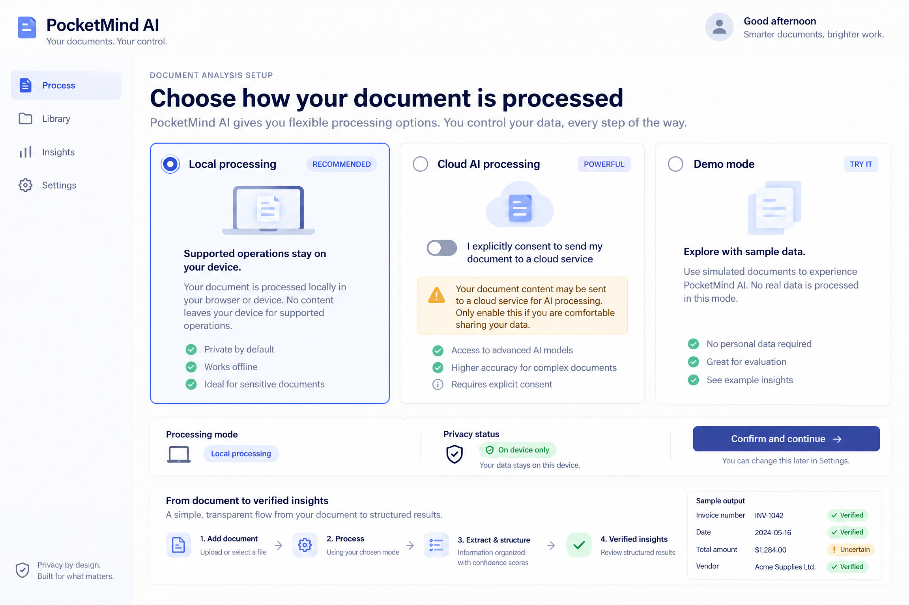

# PocketMind AI

> **#BuildHybridAI 2026 submission — Web (Chrome) · production Cloud AI verified on 2026-11-20; availability is not guaranteed**

**Live demo:** [ai-mind-law.vercel.app](https://ai-mind-law.vercel.app/) · **Source:** [maurolima-sys/ai-mind-law](https://github.com/maurolima-sys/ai-mind-law)

## What we built

PocketMind AI turns procurement documents into a structured, human-reviewable workspace. Reviewers can add PDF, DOCX, and XLSX files up to 50 MB; text is extracted in the browser with PDF.js, Mammoth, or ExcelJS. The application includes consent-gated Firebase AI Logic paths for cloud-only, on-device-only, and on-device-first hybrid inference. On 2026-11-20, production build `ed19ed4` completed a Cloud AI analysis of the fictional sample using `gemini-3.5-flash` after the primary model returned HTTP 500. This dated observation does not guarantee future availability.

The core problem: tender documents run to dozens of pages of dense prose. The obligations that decide whether a bid is eligible, technically compliant, and commercially sound are buried in that text. Reviewers re-read, cross-reference, and still miss things. PocketMind AI organizes extracted text, verifies excerpts against their cited source, and surfaces a compliance matrix for review, notes, and export. Uploaded tenders, extracted text, analyses, bidder evidence, comparisons, and review state persist in IndexedDB in the current browser; they are not encrypted or synced.

## Firebase AI Logic — how it's used at runtime

- **Hybrid inference (on-device-first):** the code configures Firebase AI Logic's web hybrid API (`getGenerativeModel` with `InferenceMode.PREFER_ON_DEVICE`) in `src/lib/services/firebaseAi.ts`. The intended path requests Chrome's on-device model first and permits Gemini cloud fallback only with consent. The 2026-11-20 production test used cloud-only mode, not hybrid.
- **Analysis recovery:** if hybrid analysis and its cloud retry fail, the application attempts on-device-only processing using smaller text sections; it reports the actual inference source and reports an error if both paths fail. Exclusive local and cloud modes do not switch processing locations.
- **Cloud-only and on-device-only modes:** selectable from the Processing & privacy screen and configured through Firebase AI Logic. Their end-to-end behavior depends on valid App Check configuration and a supported browser.
- **App Check:** development uses the debug provider; treat its token as sensitive and never commit or publish it. A manual Firebase Console check reported the production web app as **Registered (Enforced)** with reCAPTCHA Enterprise. This does not by itself prove every browser request receives a valid token; see Verification notes.
- **Document Q&A:** follow-up questions about extracted PDF, DOCX, or XLSX text use the same inference path, separating stated facts, working hypotheses, and unresolved questions, with citations to pages or source sections.

## What makes this a non-obvious use of hybrid inference

Most hybrid AI demos run a single prompt against a fixed input. PocketMind AI is designed to apply hybrid inference to a *document review workflow* where the inference source matters to the user: sensitive procurement documents may not leave the device; the app requires explicit consent before any cloud path is used and is designed to surface the reported inference source. On-device and hybrid inference still need successful end-to-end verification.

## Who it's for

Procurement and tendering teams, consultants, and anyone who reviews public or private tenders. The workflow is: upload → choose processing mode → analyze → verify findings against their source → attach bidder evidence to requirements and compare it → track review status → export CSV or JSON.

## Built during the submission period

The repository began as a standard TanStack/Lovable starter during the submission period and was substantially rebuilt into PocketMind AI. Work completed during the submission period includes: Firebase AI Logic hybrid inference integration and App Check integration (production verification pending), local PDF/DOCX/XLSX extraction and storage, source verification, the compliance matrix with persistent per-requirement review tracking, bidder evidence linking and comparison, document Q&A with structured fact/hypothesis/unresolved separation, optional LlamaParse OCR for scanned PDFs (via the Lovable connector), optional Firecrawl external research (server-side only), and the Dashboard, Library, Document analysis, Compliance matrix, Risks, Processing & privacy, Settings, and Integrations screens.

## Design references—not screenshots of this build

The images below are concept mockups used as visual references; they are not screenshots of the current application. They show navigation and workspace ideas that are not all implemented. The running app's functional navigation is **Dashboard**, **Documents**, **Analysis**, **Compliance matrix**, **Risks**, **Projects**, **Processing**, **Settings**, and **Integrations**; verify the current interface and capabilities in the live demo.




## What works

- Upload PDF, DOCX, and XLSX files up to 50 MB and extract text locally in the browser. PDF text retains page numbers; Office documents use paragraph, sheet, and row-range source labels.
- Keep tender files, extracted text, analyses, review notes, evidence files, comparison results, and activity in a persistent local browser library. This IndexedDB data is not encrypted or synced and can be deleted from the library.
- See uploaded and fictional sample metrics separately on the Dashboard; the library lists uploaded documents only. The risk register identifies origin in its filters and CSV export.
- Offer optional LlamaParse OCR for scanned or very sparse PDFs, only after separate per-document consent and when the Lovable connector is enabled.
- Select cloud-only, on-device-only, or on-device-first hybrid inference. Cloud processing and fallback require explicit consent. Cloud-only analysis succeeded in production on 2026-11-20; on-device and hybrid remain unverified end-to-end.
- Validate returned excerpts against extracted source text. The 2026-11-20 cloud analysis rendered findings from the fictional sample; individual citation correctness requires human review.
- Report the inference source supplied by Firebase separately for analyses, document answers, and evidence comparisons. A cloud response received during the current session is a past event, not a guarantee of current connectivity or valid structured output; an on-device response never marks cloud as connected. Older analyses without a recorded source are shown as unknown. The prepared sample-data workflow does not call Firebase.
- Use the built-in fictional tender text for a live model test without uploading a real procurement PDF. **Sample data** loads a prepared analysis and does not call Firebase. Live analysis sends the fictional text through the selected mode. Live results on the sample remain fictional sample content.
- Ask follow-up questions about extracted document text, with exact-text-checked page/section citations, working hypotheses, browser speech input, and optional browser text-to-speech.
- Configure interface language, the default inference mode, guided-tour narration, Q&A voice controls, and local-data deletion from Settings. Preferences use a versioned `localStorage` record with legacy locale and narration compatibility; cloud consent remains explicit and session-only.
- Run separate Firebase inference, LlamaParse availability, and ElevenLabs narration diagnostics from Integrations. The screen distinguishes configured-only checks from observed calls, records bounded metadata-only history locally, and explicitly reports App Check outcomes rather than inferring them from configuration. MCP is shown as not implemented: a hosted server cannot read the browser's private IndexedDB without an explicit, authorized bridge.
- Organize uploaded documents into local Projects with multiple document roles. Project records and links stay in IndexedDB, preserve the underlying files and analyses, and do not imply Team access or Supabase synchronization.
- Optionally search external legal sources through Firecrawl after separate consent. Only the question and jurisdiction are sent to Firecrawl; the PDF is not. Configure `FIRECRAWL_API_KEY` on the server, never in a `VITE_*` variable.
- Attach separate bidder evidence documents to tender requirements and compare their extracted text using the selected inference mode. Cloud use requires separate consent for each selected evidence document.
- Review requirements using independent source-verification, compliance-assessment, and human-review states. Assessments, review states, and notes are stored locally and exported in the compliance CSV. A verified quote does not establish compliance or approval.
- Export a document's analysis as JSON.

Accounts, shared workspaces, and cloud document storage are not implemented. Local browser data is not encrypted and may be removed by clearing browser data. AI findings and evidence comparisons are suggestions and must be checked by a person against the source document; they are not legal advice.

### Optional external OCR

When PDF.js finds no or very little selectable text, the processing screen offers LlamaParse as an optional external OCR path. The PDF is not sent until the user separately consents for that document; this consent is required even when Firebase inference is on-device. OCR requests use the server function and the Lovable connector, never a browser-side provider key. If LlamaParse does not return page-level output, the app marks citations as unverified and flags them for human review. A real scanned-PDF runtime test is still required.

### Document questions and optional legal research

Document questions use the selected Firebase AI Logic mode. Cloud inference and hybrid cloud fallback require the existing explicit cloud consent. Answers distinguish document facts from hypotheses, verify quoted excerpts against extracted text, and use source-section labels instead of page numbers when the format or OCR does not preserve page mapping. Browser speech input is optional; the browser may use its own speech service, and transcription is not submitted until the user sends the question.

External research is off by default and requires a separate checkbox consent. It sends only the question, country code, and jurisdiction to Firecrawl; it does not send the PDF or extracted document text. Set `FIRECRAWL_API_KEY` as a server-side environment variable. Search results and publication dates can be incomplete or outdated and must be checked against the issuing authority. This feature supports legal research and hypotheses; it does not provide legal advice.

## Firebase setup for live analysis

The sample dashboard works without Firebase. Live model analysis requires a Firebase project and App Check configuration:

1. Register a Firebase web app, enable Firebase AI Logic, and choose a supported Gemini API provider.
2. Enforce App Check for Firebase AI Logic. For local development, register an App Check debug token for the web app and set `FIREBASE_APPCHECK_DEBUG_TOKEN` in `.env.local`; never commit or publish it. The app requests a fresh limited-use token for each cloud request, supporting Firebase AI Logic replay protection at the cost of additional attestation latency.
3. For a public deployment, register a production App Check provider (reCAPTCHA Enterprise) for the deployed domain and configure the matching site key in the Vercel Production environment. Because Vite variables are embedded at build time, redeploy after changing the value. Confirm the site key's allowed domain and that the reCAPTCHA Enterprise API is enabled.
4. Copy `.env.example` to `.env.local` and fill in the Firebase web app configuration and App Check site key. The current initialization requires the site key even when using a local debug token.
5. Start the app and open it in desktop Chrome. To verify a live call without uploading a real tender, keep the fictional sample document selected, choose **Cloud AI** in Settings, open **Processing**, accept the consent, and click **Confirm and continue →**. App Check initializes when an AI operation starts, not when the page loads. In the Network panel, inspect the status of `exchangeDebugToken` locally and `generateContent` to distinguish token exchange from a successful model response. Do not copy or share the debug token: the Firebase SDK may print it in the console. On-device inference depends on Chrome's available model and hardware; the app reports the SDK's on-device or cloud source for each response, including mixed sources across analysis sections. A cloud response in hybrid mode does not by itself prove a local attempt occurred.

References: [Firebase AI Logic hybrid inference for Web](https://firebase.google.com/docs/ai-logic/hybrid/web/get-started), [Firebase AI Logic supported models](https://firebase.google.com/docs/ai-logic/models), [App Check and replay protection](https://firebase.google.com/docs/ai-logic/app-check), [App Check debug provider](https://firebase.google.com/docs/app-check/web/debug-provider), and [App Check reCAPTCHA Enterprise](https://firebase.google.com/docs/app-check/web/recaptcha-enterprise-provider).

The Firebase web configuration and reCAPTCHA site key are public client configuration values, not server secrets. Never put service-account keys, private API keys, or App Check debug tokens in this repository or a public production bundle. A debug token bypasses attestation and can be reused by anyone who obtains it; acceptance by a submission rule does not make production use safe. If an event explicitly permits a temporary debug-token demo, isolate it in a dedicated Firebase project and separate non-production deployment, apply strict quota budgets, and revoke it by a fixed date. Do not use the production Firebase project for that exception. Hybrid fallback can send extracted document text to Google's cloud, so the app requires explicit consent before enabling it.

Firebase AI Logic's web on-device inference uses Chrome's Prompt API and is available only in supported desktop Chrome versions. The SDK reports the inference source but does not let the app pin a particular on-device model version. PDF, DOCX, and XLSX files are converted to text before model analysis; direct file input to the model is not used. Scanned PDFs may use the separately consented external OCR path described above.

The current local checkout has no `.env.local` file with Firebase configuration committed (by design — secrets must not be committed). Set up your own Firebase project following the steps above, or open the hosted deployment at **https://ai-mind-law.vercel.app/**. Loading the dashboard does not by itself verify that live Firebase AI analysis is configured; use the live-analysis test below.

## Development

Requirements: Bun (the repository's tracked lockfile is `bun.lock`).

```sh
bun install
bun run dev
```

Checks:

```sh
bun run test
bun run lint
bun run build
```

GitHub Actions runs the full test suite and production build, plus targeted ESLint checks for the document library, evidence comparison, analysis integration, and their related tests. It does not currently lint every source file; the full local lint command may report existing formatting debt outside those checks.

## Verification notes

**Implemented:** Cloud, on-device and hybrid inference, explicit cloud consent, App Check and model fallback are in the code.

**Configured:** Production serves `v0.4.0 · ed19ed4` (build time 2026-11-19 23:54 UTC); this matched remote `main` on 2026-11-20. The deployed browser successfully exchanged a reCAPTCHA Enterprise token. Console settings were not independently inspected.

**Tested in production:** On 2026-11-20, a browser test of the fictional sample in Cloud AI mode recorded `exchangeRecaptchaEnterpriseToken` HTTP 200, `gemini-3.8-flash` HTTP 500, then `gemini-3.5-flash` HTTP 200. The analysis completed and the app displayed `Cloud (IN_CLOUD)`. The UI maps the SDK inference source to `IN_CLOUD`; the raw SDK value was not captured. This single run is not an availability guarantee.

**Not yet proved:** On 2026-11-20, an on-device-only test initialized the model but failed on the fictional sample with “The input is too large”; no Firebase AI generation request was observed. This was an integrated browser test, not a validation across supported Chrome hardware. A successful on-device or hybrid analysis and LlamaParse OCR with a real scanned PDF remain unverified.

The cloud fallback sequence is `gemini-3.5-flash` → `gemini-3.8-flash` → `gemini-3.5-flash-lite` after retryable errors (429, 500, 502, 503) or timeouts. Each section gets one bounded attempt per model; a failed primary is not repeated. Cloud requests have a 30-second per-attempt timeout and a 100-second total budget per section. Hybrid mode makes one bounded on-device-first pass, then uses the same cloud fallback sequence; it does not run both Firebase's implicit hybrid fallback and a second full cloud chain. Firebase AI Logic lists these models in its [model catalog](https://firebase.google.com/docs/ai-logic/models); for the Gemini Developer API, requests for `gemini-3.5-flash` route to `gemini-3.6-flash`.

A real scanned-PDF OCR test and responsive checks for longer Portuguese and Spanish text on small screens are still pending. Optional Firecrawl research also requires `FIRECRAWL_API_KEY` in the server-side deployment environment. The repository includes the Apache License 2.0 in the root-level `LICENSE` file.
